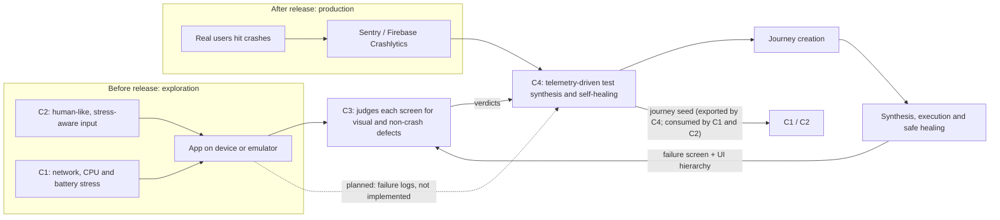
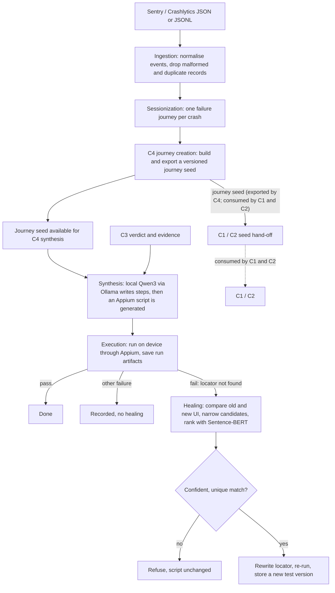

# Component 4: Telemetry-Driven Self-Healing Test Synthesis

Component 4 (C4) turns production crash telemetry into replayable Appium
regression tests, runs them on an Android device or emulator, and repairs
tests whose locators no longer match after a UI change. A repair is accepted
only when the replacement element is a confident, unique match. Otherwise C4
refuses and leaves the script unchanged. Everything runs locally: the LLM is
Qwen3 served by Ollama and semantic matching uses Sentence-BERT.

## Where C4 fits in HEART



C1 and C2 create the conditions and input that expose failures, C3 judges what
is on screen, and C4 turns real failures into regression tests and keeps them
working as the UI changes. C4 uses production telemetry and C3 verdicts; the
explicit `--no-c3` mode is reserved for offline tests and ablation runs.

## How C4 works



## Quick start

All commands run from the `component4/` folder.

```powershell
python -m c4 preflight --config target_app.json
python -m c4 run --telemetry events.json --config target_app.json --runs-dir runs --dry-run --no-c3
python -m c4 run --telemetry events.json --config target_app.json --runs-dir runs --heal --no-c3
```

## Journey creation

Journey creation is an explicit offline stage between ingestion/sessionization
and synthesis. It needs no LLM, device, or C3:

```powershell
python -m c4 journeys --telemetry events.json --source sentry `
  --out journeys --print
python -m c4 journeys --schema
```

The command writes one deterministic `JourneyDocument` per failure plus
`journeys_index.json`. Seeds are an export contract for C1 and C2; C4 does
not claim that either component consumes them. See
[the contract](docs/journey-seed-contract.md).

To synthesize from exported journeys instead of telemetry, pass exactly one
input to `run`:

```powershell
python -m c4 run --journeys journeys --config target_app.json `
  --runs-dir runs --dry-run --no-c3
```

1. `preflight` checks ADB, the device, Appium and the app package.
2. `--dry-run` generates the script without executing it. Read `synthesized_test.py` first.
3. The last command runs the test and, on a locator failure, tries to heal it.
   The example uses `--no-c3` for an offline smoke run; omit it for the normal
   C3-integrated workflow.

## Installation

From the repository root, make the repository importable (C4 uses the shared
ADB layer in `common/adb.py`), then install Component 4:

```powershell
$env:PYTHONPATH = (Get-Location).Path
pip install -e "component4[semantic]"
cd component4
```

On Linux or macOS use `export PYTHONPATH="$PWD"`. For tests only,
`pip install -e "component4[dev]"` is enough. The `semantic` extra installs
Sentence-BERT support.

Live runs need:

- an Android emulator or device (check with `adb devices`);
- the Appium server with the UiAutomator2 driver (`appium driver install uiautomator2`);
- Ollama running with `qwen3:8b` (`ollama pull qwen3:8b`);
- the C3 service, unless `--no-c3` is used.

Offline test runs can use `--no-c3`, `--embedder lexical` and an injected fake
LLM. Set `HF_HUB_OFFLINE=1` after the Sentence-BERT model has been downloaded
once, so nothing leaves the machine.

## Commands

All commands can also be invoked as `c4 ...` after installation.

### Preflight

```powershell
python -m c4 preflight --config target_app.json
```

### Run

Run Sentry telemetry with execution and healing:

```powershell
python -m c4 run `
  --telemetry events.json --source sentry `
  --config target_app.json `
  --runs-dir runs `
  --heal --embedder sbert `
  --repo-dir test-repository
```

Crashlytics input uses the same command with its own adapter:

```powershell
python -m c4 run --telemetry crash.json --source crashlytics `
  --config target_app.json --runs-dir runs
```

Useful options: `--dry-run`, `--no-c3` (disable the C3 stage for offline
runs), `--c3-strict`, `--limit`, `--model`, `--ollama-url`, `--heal-threshold`,
`--max-heal-rounds`, `--capture-baseline`, `--baseline-dir`. `--source`
defaults to `sentry`.

### Offline healing (no device, no LLM)

```powershell
python -m c4 heal --script runs\journey\synthesized_test.py `
  --step 0 --new-hierarchy runs\journey\page_source.xml `
  --embedder lexical --out decision.json
```

Add `--baseline-hierarchy FILE` to compare against an earlier hierarchy. The
command prints JSON unless `--out` is given. It exits `0` for a healed
decision, `1` for a safe refusal and `2` for bad input. Use `--embedder sbert`
for the real semantic model.

### Baseline snapshots

`--capture-baseline` saves the hierarchy before every step into the run folder.
Baseline comparison (rule R6 removes elements that did not change between the
old and new screen) is evaluated offline through `c4 heal --baseline-hierarchy`
and the evaluation harness. Reusing a baseline across app releases through the
pipeline is a known limitation, see [Limitations](#limitations).

### Evaluation

Create deterministic Settings telemetry:

```powershell
python -m evaluation.make_settings_journeys --labels labels.json --out evaluation\input
```

Synthesis and replay evaluation:

```powershell
python -m evaluation.run_synthesis_eval `
  --telemetry-dir evaluation\input `
  --config target_app.json `
  --runs-dir evaluation\runs `
  --model qwen3:8b --ollama-url http://127.0.0.1:11434
```

Use `--no-execute` for synthesis only, `--no-c3` only for a no-C3 ablation,
`--repeats N` for stability and `--limit N` to cap journeys.

Offline healing evaluation (deterministically mutated hierarchy fixtures or
real device hierarchies supplied through `--hierarchies`, with ground truth,
baselines and a threshold sweep):

```powershell
python -m evaluation.run_healing_eval --embedder lexical --out evaluation\results\healing
python -m evaluation.run_healing_eval --hierarchies evaluation\data\hierarchies `
  --embedder sbert --seed 42 --out evaluation\results\healing_sbert
```

The checked-in `evaluation/samples/` files are fabricated smoke-test fixtures;
real device dumps belong in the gitignored `evaluation/data/` directory. The
lexical embedder is for smoke tests and CI only. Report results from the
Sentence-BERT run. Outputs include scenarios, per-method results, summaries,
threshold sweep, run metadata, and counts/reasons for skipped precondition or
non-breaking mutations.

The healing evaluation compares:

- B0 exact-locator-only, which never attempts to heal;
- B1 structure-only, using ancestor-path similarity and sibling position;
- B2 semantic-only;
- B3 proposed healing with the old hierarchy as a baseline; and
- B4 proposed healing in telemetry-only mode.

Each retained scenario is verified against the new hierarchy so its recorded
locator is genuinely broken. Scenarios that fail a mutation precondition or
remain non-breaking are reported as skipped rather than included in metrics.

## C3 interface

C4 integrates with C3 (the Localized Multimodal Vision-Semantic Oracle) through
a defined verdict contract. C3 supplies visual and semantic evidence for the
failing screen, and C4 uses it in test synthesis and failure diagnosis.

**Verdict contract**

- A verdict contains `has_gui_defect`, `defect_type`, confidence, regions and
  evidence, and is validated against the contract schema on receipt.
- Regions are absolute screenshot pixels given as `x, y, width, height`, inside
  the screenshot dimensions.
- The seven defect types are `component_overlap`, `text_truncation`,
  `missing_component`, `unrendered_asset`, `functional_incongruence`,
  `frozen_state` and `other_defect`. Unknown values are mapped to
  `other_defect`.
- C4 uses the verdict as evidence in the synthesis prompt and the failure
  record. It does not modify layouts or application code.

**Evidence exchange**

- After a failed run, C4 sends the saved `page_source.xml` and `screenshot.png`
  to C3 and stores the response as `c3_verdict.json`.
- C4 reads the UI hierarchy from the Appium session and never runs
  `uiautomator dump`.
- Every pipeline record carries a `c3_status`: `not_requested`, `used`,
  `unavailable`, `invalid` or `no_evidence`. With `--c3-strict`, an
  unavailable or invalid response marks the record as an error.

**Dependencies on C3**

- The C3 service is running and reachable during live runs.
- C3 returns regions in the physical display size, with any crop offset
  applied.
- C3 does not run `uiautomator dump` on the device while a C4 Appium session is
  active, because the two sessions block each other.
- `--no-c3` disables the C3 stage for offline development and ablation runs.

## Configuration

- `configs/target_app.example.json`: package, activity or APK, device id,
  Appium URL, ADB path, reset behaviour and setup commands. Copy it to
  `target_app.json` and edit it. The local copy is not committed.
- `configs/prompts/synthesis_v1.txt`: the versioned synthesis prompt. It
  restricts actions and locator fields and requires JSON output.
- CLI flags control the model, C3, healing, capture and output locations.

## Run-folder layout

With `--runs-dir runs`, each journey is stored in `runs/<journey-id>/`:

```text
runs/
  <journey-id>/
    synthesized_test.py        generated script
    execution_result.json      execution result and attempts
    attempt-*.stdout.log       captured stdout
    attempt-*.stderr.log       captured stderr
    failure.json               failing step and exception, when a run fails
    page_source.xml            UI hierarchy at the failure
    screenshot.png             screenshot at the failure
    c3_verdict.json            C3 verdict for the failure
    baseline/step_<n>.xml      per-step snapshots with --capture-baseline
    healed_test_v<N>.py        accepted healed script versions
    healing_report.json        healing decisions, re-runs and final outcome
  <journey-id>-heal<N>/        execution of the healed script (re-run)
  pipeline_report.json         all pipeline records
```

Versioned scripts are also stored under the `--repo-dir` folder with a
`versions.json` index. Indexes are deterministic JSON; no timestamps are used.

## Healing scope

C4 heals **locator drift** in tests that C4 generated: a step fails because its
target element can no longer be found.

| Healed | Refused by design |
|---|---|
| Resource id renamed | Element or feature removed |
| Visible text or description changed | Two equally likely matches |
| Element moved to another container | Change of widget family |
| Id removed, text kept | Flow, assertion or timing changes |
| Button to image button or EditText to AutoCompleteTextView (same family) | WebView or canvas screens, iOS |
| Several broken locators in one test (bounded rounds) | LLM-invented locators (caught in synthesis) |

A candidate must reach the similarity threshold (default 0.5), clear the
ambiguity margin, and produce a locator that matches exactly one element
(resource id, then accessibility id, then text). A refusal never modifies the
original script, and every accepted repair is stored as a new version. Details:
[`docs/healing-scope.md`](docs/healing-scope.md).

## Limitations

- Execution needs a real emulator or device, Appium with UiAutomator2, ADB and
  an app configuration that launches the target.
- Synthesis needs a reachable Ollama service unless a test double is injected.
- Sentence-BERT needs the `semantic` extra and a model cache; lexical mode is
  the offline alternative and is weaker.
- Telemetry adapters depend on the provider export shapes in
  [`docs/ingestion-field-assumptions.md`](docs/ingestion-field-assumptions.md).
- Replay success is not proof that the original production crash was
  reproduced; telemetry alone does not contain the application bug.
- Evaluation telemetry that comes from datasets or hand-written files is
  synthesized, not genuine production data.
- Baselines are not yet reused across releases inside the pipeline; baseline
  comparison is evaluated offline.
- There is no shared results store or REST bus in the repository; C4 writes
  files.
- Live operation of the C3 link requires the C3 service to be running and to
  meet the interface requirements above.

## Tests

From `component4/` in a clean environment:

```powershell
python -m pytest -q -rs
```

The live Ollama and Sentence-BERT tests are opt-in through environment flags
(`C4_LIVE_LLM=1`, `C4_LIVE_SBERT=1`). The live C3 test also needs C3's extra
packages and is skipped without them.

Record experiments as described in [`docs/experiment-log.md`](docs/experiment-log.md).