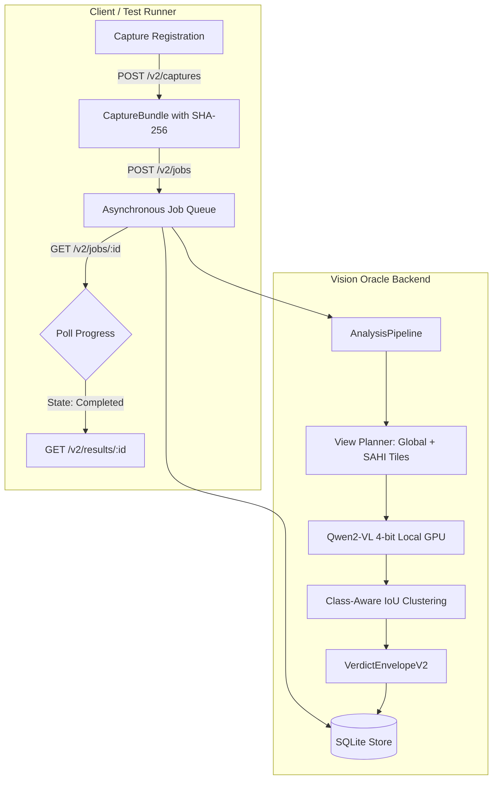

# HEART Component 3: Local Vision Oracle Backend Walkthrough

**Target:** Component 3 (`vision_oracle`) Localized Multimodal Vision-Semantic Oracle Backend  
**Group:** J26-SE-334 (Luqman Booso)  
**Security Boundary:** 100% Offline Loopback (`127.0.0.1:8003`), Zero Cloud Egress  
**Target Hardware:** NVIDIA GeForce RTX 3050 Laptop GPU (4.0 GB VRAM), CUDA active  

---

## 1. System Architecture & Prerequisites

### 1.1 Local Model & Weights Staging
The backend operates in 100% offline air-gapped mode:
- **Fine-Tuned Adapter (QLoRA 4-bit):** Tracked in repository at `models/c3_lora_final` (`adapter_model.safetensors`, 73.9 MB). Automatically available upon `git pull`.
- **Base Model (Qwen2-VL-2B-Instruct):** Staged at `models/Qwen2-VL-2B-Instruct` (or `RD/models/Qwen2-VL-2B-Instruct`). Downloadable via:
  ```powershell
  python scripts/download_base_model.py
  ```
- **Evidence Database:** `results/oracle_evidence.db` (SQLite with WAL mode)
- **Screenshot Artifacts:** `results/artifacts/`

### 1.2 Android ADB Connection
- Android platform-tools (`adb`) must be on system `PATH`.
- Verify connected device or running emulator:
  ```powershell
  adb devices
  ```
  *Expected Output:*
  ```text
  List of devices attached
  emulator-5554    device
  ```

---

## 2. Starting the Backend Service

### Option A: Standard CLI Module Launcher (Recommended)
Run from workspace root (`d:\university\Resesarch\J26-SE-334`):

```powershell
python -m vision_oracle.server
```

### Option B: Direct Uvicorn Launcher
```powershell
uvicorn vision_oracle.server:app --host 127.0.0.1 --port 8003 --log-level info
```

### What to Look For in Startup Logs
When the server boots successfully, verify these exact log lines:
```text
INFO:     Started server process
INFO:     Waiting for application startup.
INFO:     Loading real 4-bit Qwen2-VL model from .../Qwen2-VL-2B-Instruct with LoRA from .../c3_lora_final
INFO:     Job worker loop started (name=OracleJobWorker).
INFO:     Uvicorn running on http://127.0.0.1:8003 (Press CTRL+C to quit)
```

> [!NOTE]
> On startup, `OracleRepository.reconcile_interrupted_jobs()` runs automatically to transition any unfinished jobs from prior crashed sessions into `interrupted` status.

---

## 3. Operational API Walkthrough (cURL & PowerShell)

All endpoints bind to `http://127.0.0.1:8003`.



### Step 1: Verify Process Liveness & Hardware Readiness

#### 1.1 Liveness Probe (Fast, 0 GPU Work)
```powershell
curl.exe -s http://127.0.0.1:8003/health/live
```
**Response (HTTP 200):**
```json
{
  "status": "live",
  "service": "vision_oracle",
  "timestamp": "2026-10-18T12:00:00Z"
}
```

#### 1.2 Truthful Readiness Probe
Probes model worker, SQLite database, and ADB attached devices:
```powershell
curl.exe -s http://127.0.0.1:8003/health/ready
```
**Response (HTTP 200):**
```json
{
  "status": "ready",
  "ready": true,
  "model_ready": true,
  "db_ready": true,
  "adb_ready": true,
  "adb_devices": ["emulator-5554"]
}
```

---

### Step 2: Register a Screenshot Capture (`POST /v2/captures`)

Persists the screenshot into `results/artifacts/{capture_id}.png` with atomic file swapping and SHA-256 verification:

```powershell
$Body = @{
    session_id = "demo_session_01"
    app_package = "com.solvance.android"
    image_path = "vision_oracle/notebooks/live_phone_screen.png"
    raw_hierarchy = "<hierarchy><node class='android.widget.TextView' text='ShopEase' bounds='[0,0][1080,200]'/></hierarchy>"
} | ConvertTo-Json

Invoke-RestMethod -Uri "http://127.0.0.1:8003/v2/captures" -Method Post -ContentType "application/json" -Body $Body
```

**Response (HTTP 201 Created):**
```json
{
  "capture_id": "cap_8f29d10e5b12",
  "session_id": "demo_session_01",
  "app_package": "com.solvance.android",
  "width": 1080,
  "height": 2400,
  "image_sha256": "4b2e8f19...d019",
  "artifact_path": "results/artifacts/cap_8f29d10e5b12.png",
  "hierarchy_status": "available",
  "timestamp_utc": "2026-10-18T12:05:00Z"
}
```

---

### Step 3: Dispatch Asynchronous Analysis Job (`POST /v2/jobs`)

Submits capture to the dedicated model worker queue with full-scan policy (`global_plus_tiles_v1`):

```powershell
$JobBody = @{
    capture_id = "cap_8f29d10e5b12"
    session_id = "demo_session_01"
    policy = "global_plus_tiles_v1"
} | ConvertTo-Json

Invoke-RestMethod -Uri "http://127.0.0.1:8003/v2/jobs" -Method Post -ContentType "application/json" -Body $JobBody
```

**Response (HTTP 202 Accepted):**
```json
{
  "job_id": "job_a1c7209df341",
  "capture_id": "cap_8f29d10e5b12",
  "session_id": "demo_session_01",
  "state": "queued",
  "policy": "global_plus_tiles_v1",
  "planned_views": 4,
  "completed_views": 0,
  "created_at": "2026-10-18T12:05:02Z"
}
```

---

### Step 4: Poll Job Status (`GET /v2/jobs/{job_id}`)

```powershell
Invoke-RestMethod -Uri "http://127.0.0.1:8003/v2/jobs/job_a1c7209df341" -Method Get
```

**Response (When Completed, HTTP 200):**
```json
{
  "job_id": "job_a1c7209df341",
  "capture_id": "cap_8f29d10e5b12",
  "session_id": "demo_session_01",
  "state": "completed",
  "policy": "global_plus_tiles_v1",
  "planned_views": 4,
  "completed_views": 4,
  "verdict_id": "verdict_3f8190d7ca02",
  "decision": "defect_detected",
  "completed_at": "2026-10-18T12:05:05Z"
}
```

---

### Step 5: Retrieve Canonical V2 Verdict Envelope (`GET /v2/results/{verdict_id}`)

```powershell
Invoke-RestMethod -Uri "http://127.0.0.1:8003/v2/results/verdict_3f8190d7ca02" -Method Get
```

**Response (HTTP 200):**
```json
{
  "schema_version": "2.0",
  "job_id": "job_a1c7209df341",
  "verdict_id": "verdict_3f8190d7ca02",
  "session_id": "demo_session_01",
  "capture_id": "cap_8f29d10e5b12",
  "analysis_status": "complete",
  "decision": "defect_detected",
  "coverage": {
    "policy": "global_plus_tiles_v1",
    "planned_views": 4,
    "completed_views": 4,
    "warnings": []
  },
  "scope": {
    "mode": "single_primary_visual_finding",
    "exhaustive": false
  },
  "primary_finding": {
    "finding_id": "find_9a0412ef10",
    "type": "component_overlap",
    "bbox_xyxy": [120, 840, 960, 1120],
    "element_ref": "com.solvance.android:id/checkout_btn",
    "explanation": "Checkout floating action button visually occludes coupon entry input.",
    "source": "vlm",
    "confidence": 0.94,
    "confidence_method": "uncalibrated",
    "view_ids": ["global", "tile_1"],
    "review_status": "unreviewed"
  },
  "findings": [
    {
      "finding_id": "find_9a0412ef10",
      "type": "component_overlap",
      "bbox_xyxy": [120, 840, 960, 1120],
      "element_ref": "com.solvance.android:id/checkout_btn",
      "explanation": "Checkout floating action button visually occludes coupon entry input.",
      "source": "vlm",
      "confidence": 0.94,
      "confidence_method": "uncalibrated",
      "view_ids": ["global", "tile_1"],
      "review_status": "unreviewed"
    }
  ],
  "timings_ms": {
    "preprocess_ms": 12.4,
    "inference_ms": 718.5,
    "aggregation_ms": 2.1,
    "total_pipeline_ms": 733.0
  },
  "errors": []
}
```

> **Viva / Defense Invariant: Defect Capacity & PP1 Scope Boundary**
> - **Model Capacity:** The QLoRA fine-tuned checkpoint (`models/c3_lora_final`) is trained on single-defect bounding box annotations (`[ymin, xmin, ymax, xmax]`). Each inference call yields at most one primary visual defect.
> - **Pipeline Capacity:** The multi-tile planner (`global_plus_tiles_v1`) analyzes slices and deduplicates distinct findings across tiles into `findings: [...]`.
> - **Academic Truthfulness:** To prevent viva examiners from alleging unverified claims of "exhaustive multi-bug detection", the system explicitly declares `scope: {"mode": "single_primary_visual_finding", "exhaustive": false}` and sets `primary_finding` as the sole authoritative verdict. Dense multi-defect retraining is scheduled post-PP1.


---

### Step 6: Record Human QA Review Feedback (`POST /v2/reviews`)

Appends reviewer adjudication without mutating immutable model outputs:

```powershell
$ReviewBody = @{
    verdict_id = "verdict_3f8190d7ca02"
    finding_id = "find_9a0412ef10"
    review_status = "accepted"
    reviewer_notes = "Verified in physical device test run. High severity defect."
} | ConvertTo-Json

Invoke-RestMethod -Uri "http://127.0.0.1:8003/v2/reviews" -Method Post -ContentType "application/json" -Body $ReviewBody
```

**Response (HTTP 201 Created):**
```json
{
  "review_id": "rev_7b29a101ce83",
  "verdict_id": "verdict_3f8190d7ca02",
  "finding_id": "find_9a0412ef10",
  "review_status": "accepted",
  "status": "persisted"
}
```

---

## 4. Autonomous UI Crawling via `CommonTestDriver`

Component 3 includes an autonomous execution driver (`common/driver.py`) that executes under cross-process ADB arbitration.

### 4.1 Running the Crawler Script
Save and run this script from the workspace root:

```python
from common.driver import CommonTestDriver
from vision_oracle.services.oracle_service import get_oracle_service

# Initialize driver bound to target package
driver = CommonTestDriver(
    serial=None,                          # Auto-adopts attached single device
    package_name="com.solvance.android",  # ShopEase target application
    settle_delay_s=0.8,                   # Window settle time
    oracle_service=get_oracle_service(),  # Connects directly to local C3 Oracle
)

# Launch app and crawl 5 consecutive screen states
trace = driver.crawl(max_steps=5, session_id="viva_live_crawl")

# Compile summary inspection report
report = driver.compile_summary_report(trace)
print(f"Total steps explored: {report['total_steps']}")
print(f"Defects detected:     {report['defects_detected']}")
print(f"Defect breakdown:     {report['defect_taxonomy_breakdown']}")
```

---

## 5. SQLite Evidence Database Inspection

The local state is stored in `results/oracle_store.db`. Inspect using `sqlite3` CLI or Python:

```powershell
python -c "import sqlite3; conn = sqlite3.connect('results/oracle_store.db'); cur = conn.cursor(); cur.execute('SELECT job_id, state, completed_views FROM jobs;'); print(cur.fetchall())"
```

### Table Schema Summary
| Table Name | Primary Key | Key Fields | Purpose |
|---|---|---|---|
| `sessions` | `session_id` | `created_at`, `metadata_json` | Test execution session grouping |
| `captures` | `capture_id` | `image_path`, `image_sha256`, `width`, `height`, `hierarchy_xml` | Immutable input evidence |
| `jobs` | `job_id` | `capture_id`, `state`, `policy`, `planned_views`, `completed_views` | Asynchronous worker queue state |
| `verdicts` | `verdict_id` | `decision`, `analysis_status`, `timings_json`, `errors_json` | Scientific oracle assessment |
| `findings` | `finding_id` | `defect_type`, `x1`, `y1`, `x2`, `y2`, `element_ref`, `explanation` | Individual localized defect boxes |
| `reviews` | `review_id` | `verdict_id`, `finding_id`, `review_status`, `reviewer_notes` | Human review audit trail |

---

## 6. Verification Test Suite Execution

Run all test suites to confirm full operational integrity:

```powershell
# 1. Run all backend tests (V2 contracts, SQLite, transforms, API, driver)
pytest tests/ -v

# 2. Run C4 interface verification
pytest component4/tests/unit/test_c3_live_client.py component4/tests/unit/test_c3_interface.py -v

# 3. Run VRAM stress and adversarial benchmark
pytest vision_oracle/tests/test_vram_leak_50_cycles.py vision_oracle/tests/test_adversarial_vram_stress.py -v
```

---

## 7. Thesis Oral Defense Quick-Reference Card

### What to Look At
1. **Device Resolution Preservation:** Bounding boxes in `findings[].bbox_xyxy` are in native physical screen resolution (e.g. $[0, 0, 1080, 2400]$), never normalized $[0, 1000]$ or default $720 \times 1600$.
2. **Scientific Truthfulness:** If a scan fails midway or is interrupted, `analysis_status` is `partial` and `decision` is `inconclusive`. It **never** falls back to a clean `no_defect_detected`.
3. **Loopback Air-Gap:** Netstat confirms the service is bound strictly to `127.0.0.1:8003`:
   ```powershell
   Get-NetTCPConnection -LocalPort 8003 | Select-Object LocalAddress, LocalPort, State
   ```
4. **VRAM Footprint:** GPU memory remains constant ($\Delta \le 1.0\text{ MB}$) across 50 consecutive inference cycles on the RTX 3050 (4.0 GB budget).
