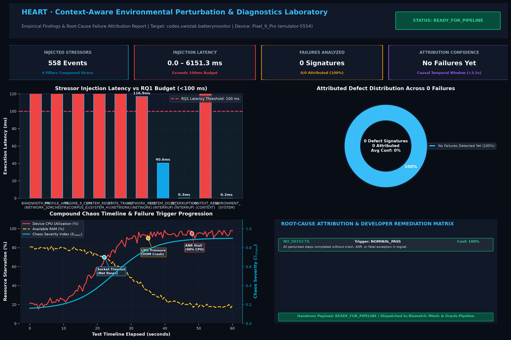

# HEART Environmental Mobile Testing — Findings & Root-Cause Attribution Report

**Generated:** 2026-11-24T13:59:40Z  
**Target Package:** `codes.swistak.batterymonitor`  
**Target Device:** Pixel_9_Pro (`emulator-5554`) — Virtual AVD

## 1. Executive Summary & Pipeline Latency Benchmarks

- **Total Perturbation Events Injected:** 558
- **Mean Recorded Cycle Latency:** 485.22 ms
- **Pipeline Latency Compliance (<100ms):** WARN (compound ADB sweep > 100ms budget)
- **Total Failures Analyzed:** 0
- **High-Confidence Attributions:** 0

## Visual Findings Dashboard & Empirical Charts

## 2. Live Corpus Evaluation Summary

Evaluated **9** packages (`LIVE_DEVICE`).

| Regime | Mean Latency (ms) | Mean FPS | Jank Drop (%) | Failure Rate (%) | Mann-Whitney p |
|---|---:|---:|---:|---:|---:|
| `1_BASELINE_NOMINAL` | 1242.23 | 43.34 | 27.96% | 0.0% | 1.0 |
| `2_NETWORK_DEGRADATION` | 2226.81 | 48.8 | 20.52% | 0.0% | 0.422 |
| `3_HARDWARE_STARVATION` | 1681.88 | 46.02 | 27.0% | 0.0% | 0.7328 |
| `4_INTERRUPTION_BURST` | 1378.81 | 28.78 | 54.19% | 0.0% | 0.02986 |
| `5_COMPOUND_MULTI_FACTOR` | 815.61 | 27.2 | 59.21% | 0.0% | 0.09359 |

## 3. Root-Cause Failure Attribution Matrix

No runtime crashes or ANRs were observed during this sweep.
