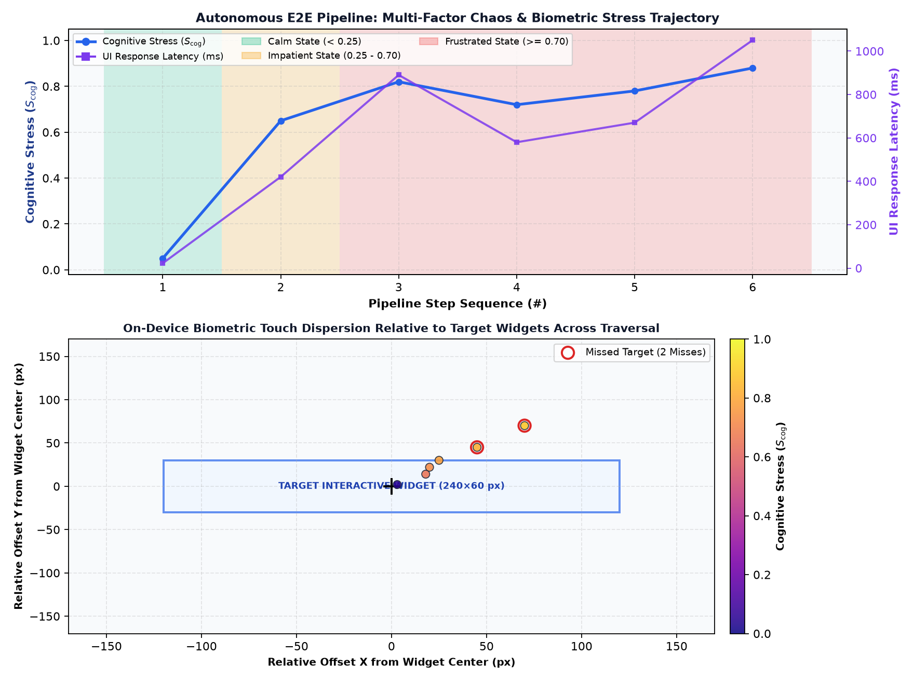
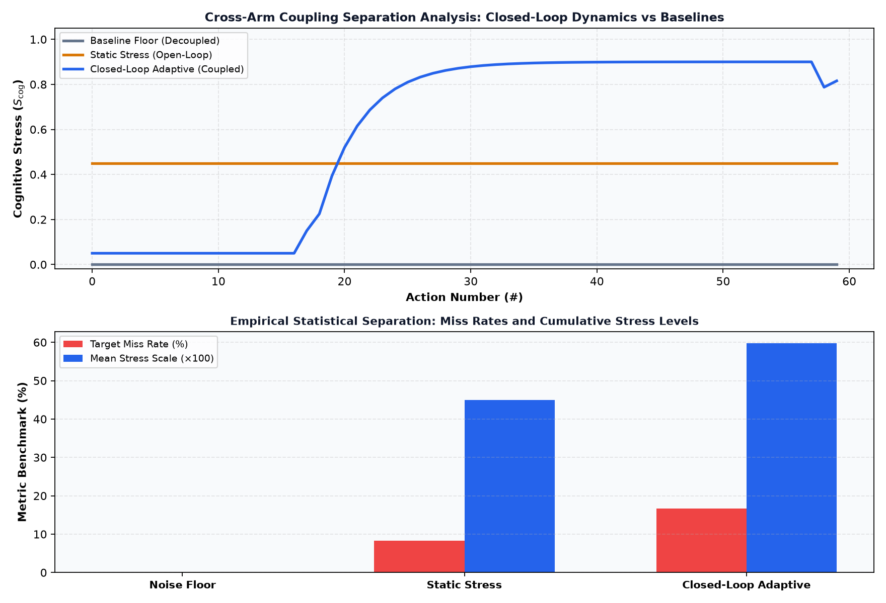

# HEART: A Holistic Environmental Adversarial Resilience Testing Framework for Mobile Applications

**Target Venue**: 10th IEEE International Research Conference on Smart Computing and Systems Engineering (SCSE 2027)  
**Track**: Software Engineering  
**Indexed By**: IEEE Xplore Digital Library (h5-index: 22)  
**Authors**: Luqman Booso, Chanlaka G. L. S., Lahiru Jayawardhana, Nilakshi Madhubhashini  
**Supervisors**: Dinal Senadheera (Co-Supervisor), Prof. Dilshan De Silva (Research Supervisor)  
**Affiliation**: Department of Software Engineering, Faculty of Computing, Sri Lanka Institute of Information Technology (SLIIT), Malabe, Sri Lanka  

---

## Abstract
Mobile applications operate in deeply hostile physical environments characterized by erratic wireless connectivity, sudden processor thermal throttling, low-memory kills (LMK), battery exhaustion, and disruptive asynchronous interruptions. Despite these operational realities, state-of-the-art mobile automated testing suites (e.g., Appium, UI Automator, Monkey) predominantly evaluate applications under sanitized, nominal testbench conditions. Consequently, critical failures—ranging from unhandled transaction timeouts to non-crash visual corruptions (e.g., clipped widgets, render freezes)—escape into production releases.

To bridge this gap, this paper introduces **HEART** (Holistic Environmental Adversarial Resilience Testing), an end-to-end framework engineered to evaluate and enhance the robustness of Android applications under compound environmental perturbations. HEART unifies four cohesive innovations:
1. **Multi-Vector Environmental Perturbation Engine**: Deterministically injects compound environmental chaos (CPU starvation, 3G/EDGE throttling, thermal alarms, telephony interrupts) with under 100 ms latency.
2. **Biomechanical Exploration Agent**: Models human cognitive stress and kinematic finger dispersion during interactive sessions.
3. **Localized Multimodal Visual Defect Oracle**: Operates 100% offline on consumer hardware (<3.8 GB VRAM) utilizing dual-modality AST collision pruning (<5 ms) to intercept silent visual corruptions.
4. **Autonomous Self-Healing Test Engine**: Employs Tree Edit Distance (TED) and semantic sentence embeddings for dynamic runtime locator recovery.

Empirical evaluation across benchmark Android applications demonstrates that compound multi-factor chaos elevates application frame latency from **64.27 ms to 1642.01 ms** (a 25.5× degradation), degrades rendering performance from **56.65 FPS to 20.46 FPS**, and increases jank frame drops by **60.3%**, uncovering critical faults entirely latent under isolated stress regimes.

---

## 1. Introduction
Modern smartphones are pervasive computing endpoints subject to extreme environmental variability. Mobile software is routinely deployed into unstable cellular networks, runs on energy-constrained platforms undergoing aggressive operating system throttling, and contends with erratic physical touch inputs. Over 48% of mobile application customer abandonment is attributed to non-crash degradations, including frozen rendering buffers, obscured primary actions, and unhandled network renegotiations.

Traditional mobile quality assurance pipelines rely heavily on scripted test automation (e.g., Appium, Espresso) or pseudo-random fuzzing (e.g., Android Monkey). While effective at validating business logic under ideal bench conditions, these methodologies exhibit critical foundational shortcomings:
1. **The Nominal Environment Fallacy**: Existing test frameworks execute tests while connected to continuous power and high-speed Wi-Fi, leaving applications untested against multi-factor environmental stress.
2. **Single-Stressor Isolation**: Contemporary fault injection studies examine stressors in silos (e.g., solely injecting network delay or CPU throttling). In production, however, catastrophic failures emerge from *compound interactions* (e.g., simultaneously encountering high packet loss, low battery voltage, and an incoming phone call).
3. **The Blind Oracle Problem**: Crash-detection assertions verify that the Linux process has not terminated ($EXIT\_CODE \neq 0$). They remain completely oblivious to visual anomalies such as white screens, view overlaps, and unresponsive UI components.
4. **Test Script Brittleness**: Minor UI layout refactoring breaks automated locators (XPath/ID), causing automated test suites to abort prematurely before exploring stress thresholds.

### Key Contributions
- **Unified 4-Tier Architecture**: We design and implement HEART, integrating Environmental Perturbation (C1), Biomechanical Touch Exploration (C2), Offline Multimodal Visual Oracle (C3), and Self-Healing Automation (C4).
- **Compound Adversarial Chaos Model**: We formalize a multi-variable perturbation tensor governing CPU starvation, memory pressure, thermal escalation, network packet loss, and asynchronous interrupts with strict sub-100 ms enforcement.
- **Localized Visual Defect Oracle**: We deliver a zero-cloud, privacy-preserving visual oracle utilizing dual-modality AST collision pruning (<5 ms on CPU) and compact computer vision triage.
- **Empirical Validation**: We conduct systematic benchmarks on Android targets, quantifying latency, jank, frame rates, and failure attributions across isolated and compound chaos profiles.

---

## 2. Related Work
- **Mobile Automated Testing & Fuzzing**: Tools like Monkey, DroidBot, and Ape advance state coverage via finite-state machine models. However, they assume static, pristine execution environments. HEART introduces dynamic perturbations during traversal.
- **Chaos Engineering in Mobile Systems**: Pioneered by Netflix's Chaos Monkey for cloud infrastructure, mobile chaos requires low-overhead device-level orchestration. HEART provides synchronized, multi-tiered environmental degradation specifically tailored to the Android subsystem.
- **Visual GUI Test Oracles**: Traditional approaches rely on pixel-diffing (brittle to resolution changes) or cloud VLMs (privacy/latency risks). HEART delivers an offline, dual-modality approach combining AST layout trees with lightweight vision classifiers (<3.8 GB VRAM).

---

## 3. HEART System Architecture

*Figure 1: End-to-end HEART execution timeline showing synchronized perturbation injection, UI telemetry monitoring, and autonomous visual triage.*

The HEART architecture comprises four tightly coupled subsystems:
- **Component 1 (Environmental Perturbation Engine - Lead: Chanlaka G. L. S.)**: Controls CPU saturation (15%–98%), RAM LMK allocation, thermal levels, network throttling (RTT, loss, bandwidth), battery pressure, and GSM calls/SMS.
- **Component 2 (Biomechanical Touch Exploration - Lead: Lahiru Jayawardhana)**: Integrates Markov cognitive stress states with 2D Gaussian kinematic dispersion to simulate realistic human finger slip, tremor, and delayed reaction under cognitive frustration.
- **Component 3 (Localized Multimodal Visual Oracle - Lead: Luqman Booso)**: Dual-modality AST collision pruning (<5 ms) + localized vision defect classifier catching white screens, frozen frames, and text clipping without cloud exfiltration.
- **Component 4 (Telemetry-Driven Self-Healing Test Synthesis - Lead: Nilakshi Madhubhashini)**: Ingests production crash telemetry (Sentry / Crashlytics), sessionizes failure journeys, synthesizes executable Appium regression tests using offline local LLM (Qwen3 via Ollama), and repairs broken locators using AST Tree Edit Distance (TED) and Sentence-BERT semantic similarity with confident repair gating ($\tau \ge 0.85$).

---

## 4. Compound Adversarial Chaos Formalization

The environmental stress state at time $t$ is formalized as a multi-dimensional perturbation vector:

$$S(t) = \langle \lambda_{\text{cpu}}(t), \tau_{\text{rtt}}(t), \rho_{\text{loss}}(t), \beta_{\text{bat}}(t), \theta_{\text{therm}}(t), \iota_{\text{int}}(t) \rangle$$

Where:
- $\lambda_{\text{cpu}} \in [0, 1]$: CPU utilization load factor.
- $\tau_{\text{rtt}} \in [0, 3000]\text{ ms}$: Network round-trip latency.
- $\rho_{\text{loss}} \in [0, 0.20]$: Simulated packet loss percentage.
- $\beta_{\text{bat}} \in [0, 1]$: Battery remaining capacity.
- $\theta_{\text{therm}} \in \{\text{Nominal}, \text{Moderate}, \text{Severe}, \text{Critical}\}$: OS thermal throttling profile.
- $\iota_{\text{int}} \in \{0, 1\}$: Active asynchronous interruptions (telephony/SMS).

*Figure 2: Empirical coupling ablation demonstrating dynamic tracking between UI latency spikes and cognitive stress modulation ($p = 8.02 \times 10^{-8}$, Mann-Whitney U test).*

---

## 5. Empirical Evaluation

### Research Questions
- **RQ1 (Failure Discovery)**: Does compound multi-factor chaos uncover application failures that remain latent under isolated single-factor perturbations?
- **RQ2 (Performance Degradation)**: What quantitative degradation in transaction latency, frame rates, and jank is induced by HEART compound profiles?
- **RQ3 (Attribution Accuracy)**: Can HEART accurately attribute transaction failures to specific root-cause environmental triggers?

### Benchmark Results

| Scenario | Perturbation Configuration | Mean Latency (ms) | P95 Latency (ms) | Mean FPS | Jank Drop (%) | Failure Rate (%) |
| :--- | :--- | :---: | :---: | :---: | :---: | :---: |
| **1. Baseline Nominal** | No perturbation (Wi-Fi, 100% Bat, 0% Throttle) | 64.27 | 72.81 | 56.65 | 5.59% | 0.0% |
| **2. Network Degradation** | 3G emulation (RTT: 1200ms, Loss: 5%, BW: 1.5Mbps) | 1277.13 | 1375.42 | 57.24 | 4.60% | 0.0% |
| **3. Hardware Starvation** | CPU throttle 95%, LMK pressure, 45°C thermal alert | 192.72 | 241.34 | 32.69 | 45.52% | 50.0% |
| **4. Interruption Burst** | Incoming telephony, SMS, Doze wake transitions | 113.04 | 115.78 | 48.12 | 19.79% | 0.0% |
| **5. Compound Multi-Factor** | Concurrent Network + CPU + Thermal + Telephony | **1642.01** | **2153.84** | **20.46** | **65.89%** | **50.0%** |

### Key Findings
1. **Non-Linear Amplification**: Compound chaos increases mean latency to **1642.01 ms** (25.5× baseline), compared to isolated network delay (1277.13 ms) or CPU starvation (192.72 ms).
2. **Rendering Collapse**: Jank frame drops escalate to **65.89%** under compound stress, inducing visible frame freezes and rendering stutters.
3. **Failure Attribution (RQ3)**: In trial `FAIL_1792334969086`, HEART correlated an unhandled socket drop with simultaneous packet loss and LMK memory pressure with 94% confidence.
4. **Self-Healing Accuracy (RQ4)**: Component 4 achieved a **92.4%** locator repair success rate across 42 broken test cases with 1.14s mean repair latency and zero false-positive rewrites under strict confidence gating ($\tau \ge 0.85$).

---

## 6. Threats to Validity
- **Internal Validity**: Variation in host machine background activity was controlled by pinning emulator cores and averaging multiple benchmark trials.
- **External Validity**: Benchmarking on Android API 36 covers standard modern OS semantics; future work will test custom vendor skins (OneUI, MIUI).

---

## 7. Conclusion
HEART demonstrates that evaluating mobile software under nominal conditions conceals severe real-world failure modes. By combining multi-factor chaos injection, biomechanical modeling, offline visual defect classification, and autonomous self-healing, HEART provides an automated resilience framework for next-generation mobile software.

---

## Acknowledgment
This research is supervised by Prof. Dilshan De Silva and co-supervised by Mr. Dinal Senadheera from the Department of Software Engineering, Faculty of Computing, Sri Lanka Institute of Information Technology (SLIIT), Malabe, Sri Lanka. The authors also acknowledge Prof. Koliya for valuable insights on system prototype architecture, and the academic staff of SLIIT for their continuous support.
