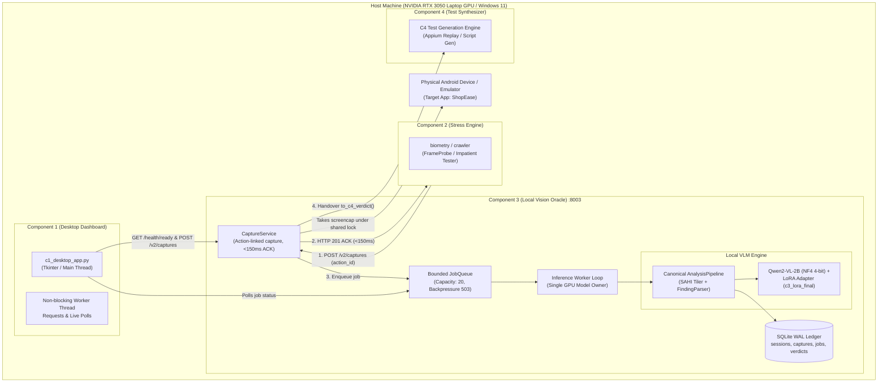

# Component 3 Architecture & Operational Blueprint

**Component:** Component 3 (Local Vision-Semantic Test Oracle)  
**System:** HEART (Hybrid Exploration & Automated Regression Testing)  
**Lead:** M.L. Booso (IT23452916)  
**Version:** 2.0.0 (PP1 Baseline)  

---

## 1. System Architecture Diagram

---

## 2. Core Architectural Principles

### 2.1 Single Model Ownership
- **Strict Rule:** Component 3 is the **sole owner** of the Vision-Language Model in the operating system.
- Component 1 (Desktop GUI), Component 2 (Stress Engine), and Component 4 (Test Synthesizer) **never load another model instance**.
- All components interact with C3 through REST API v2 loopback endpoints (`http://127.0.0.1:8003`).

### 2.2 Canonical Analysis Pipeline
- Every visual analysis request (manual image upload, live ADB screencap, C2 trigger, or test suite evaluation) executes through a single unified class: `vision_oracle.local_vision_oracle.pipeline.AnalysisPipeline`.
- Legacy endpoints (`/api/oracle/evaluate`, `/api/oracle/evaluate-device`) are thin compatibility wrappers that delegate directly to `AnalysisPipeline`.

### 2.3 Decoupled Action-Linked Capture
- C2 actions trigger a synchronous capture request:
  `POST /v2/captures` with `{session_id, action_id, app_package}`.
- CaptureService acquires the shared ADB lock, takes the screencap, validates foreground package, generates SHA-256 hash, and returns an immediate HTTP 201 ACK ($p50 < 112\text{ ms}$) containing `capture_id` and `job_id`.
- The expensive VLM inference pass (~1.5s) executes asynchronously in the bounded queue, ensuring C2's interaction cadence is never degraded.

### 2.4 Durable Persistence & ACID Guarantees
- Persistence is managed by SQLite in Write-Ahead Logging (WAL) mode (`vision_oracle/persistence/db.py`).
- Image files are stored using atomic filesystem writes with hex-digest naming (`captures/<hash>.png`).
- Interrupted jobs from sudden process terminations are reconciled to `interrupted` status on startup.

### 2.5 Contract V2 & C4 Inter-Component Handover
- Contract schema: `vision_oracle.contracts.v2.VerdictEnvelopeV2`.
- Inconclusive results preserve `has_gui_defect = None` (nullable).
- Adapter `to_c4_verdict()` formats predictions for C4 consumption, emitting typed handover tags:
  - `ready_for_test_generation`: Defect confirmed with bounding box.
  - `evidence_only`: Clean screen or uncontextualized capture.
  - `unsupported_inconclusive`: Corrupted or partial scan requiring triage.
